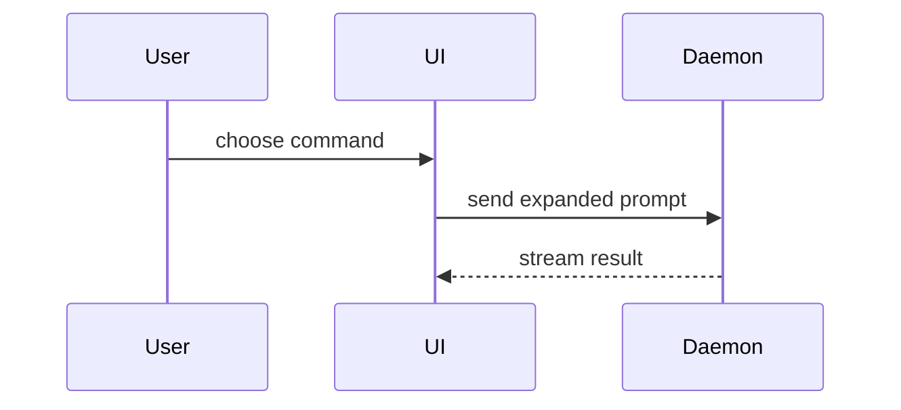

# Visuals for `## What`

Pick the smallest view that makes the change clear, and put it next to the
sentence it supports. Keep only the calls, files, props, states and boundaries
the reviewer needs. One view is usually enough; never all of them.

Logic or an algorithm, as pseudocode:

```text
on(save)
  if content is unchanged
    return cached result
  write new content
  return fresh result
```

Runtime control flow, as a call tree:

```text
submitForm
  createSession
    persistPrompt
    launchAgent
  navigateToSession
```

UI structure, as a component tree with the state and module boundaries that
matter:

```text
<SessionPage> (apps/example/src/routes/session.tsx)
  useSessionEvents()
  <SessionToolbar>
    <RunSkillButton> (packages/ui)
```

File responsibility or a broad refactor, as a shallow file tree:

```text
src/
├── commands/       # parses user actions
├── sessions/       # owns session state
└── transport/      # sends API requests
```

Interaction between components, control flow or data flow, as Mermaid:



What changes in a shape that already exists, as a `diff` of that shape (call
tree, component tree, file tree or control flow):

```diff
 submitForm
   createSession
     persistPrompt
+    expandSkillMention
     launchAgent
-  navigateToSession
+  navigateToSession
+    subscribeToEvents
```

```diff
 on(save)
-  write content
+  if content is unchanged
+    return cached result
+  write new content
+  invalidate cache
```

The whole block, when most of it is new, when cut context would hide
ownership or order, or when the reviewer needs a copyable target shape.
